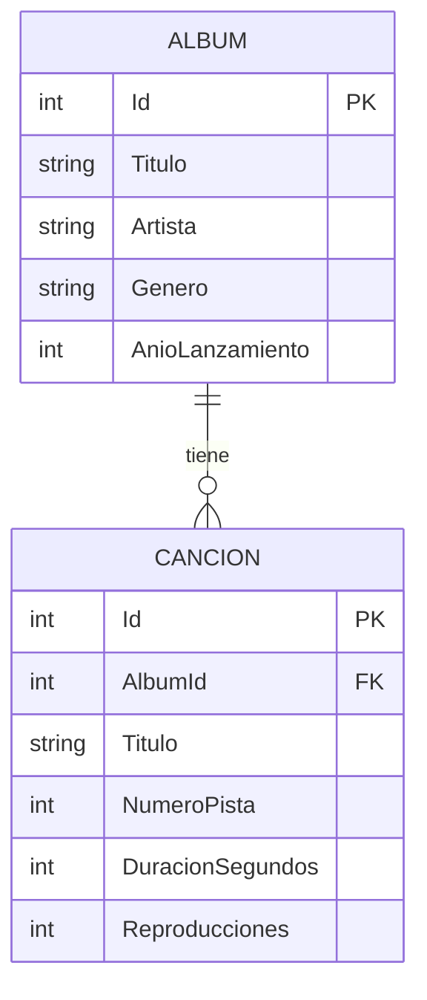

# Musica API · Web API REST con ASP.NET Core

API REST para administrar un catálogo de **álbumes y canciones**, desarrollada con **ASP.NET Core (.NET 10)** y **Entity Framework Core (Database First)**. La API y su base de datos SQL Server están publicadas en la nube, con documentación en Swagger.


## Datos del curso

| | |
|---|---|
| **Curso** | Desarrollo de Aplicaciones Empresariales Avanzadas |
| **Sección** | 6 - C24 - Sección C  |
| **Docente** | Edwin William Arévalo Sermeño |
| **Laboratorio** | Web API REST (Semana 12) |
| **Institución** | TECSUP |

## Qué problema resuelve

Permite guardar y consultar en un solo lugar el catálogo de álbumes y sus canciones. Cualquier aplicación (web o móvil) puede usar la API por internet, sin conectarse directo a la base de datos, para agregar, editar, eliminar y filtrar álbumes y canciones.

## Tecnologías

- ASP.NET Core Web API (.NET 10) con controladores
- Entity Framework Core + SQL Server (Database First con Scaffold)
- LINQ y Data Annotations
- Swagger (OpenAPI + SwaggerUI)
- CORS con un origen concreto
- Hosting y base de datos: **MonsterASP.NET** (plan gratuito)

## Modelo de datos

Relación **1:N**: un álbum tiene muchas canciones y cada canción pertenece a un solo álbum.



## Reglas de negocio (409 Conflict)

1. No se puede repetir un álbum con el mismo título y artista.
2. No se puede repetir el número de pista dentro del mismo álbum.
3. No se puede eliminar un álbum que ya tiene canciones.

## Endpoints

### Álbumes · `/api/albumes`

| Método | Ruta | Descripción |
|---|---|---|
| GET | `/api/albumes` | Lista álbumes. Filtros: `artista`, `genero`, `anio`, `q` |
| GET | `/api/albumes/{id}` | Obtiene un álbum |
| GET | `/api/albumes/{id}/canciones` | Canciones de un álbum (ruta anidada) |
| POST | `/api/albumes` | Crea un álbum |
| PUT | `/api/albumes/{id}` | Actualiza un álbum |
| DELETE | `/api/albumes/{id}` | Elimina un álbum |

### Canciones · `/api/canciones`

| Método | Ruta | Descripción |
|---|---|---|
| GET | `/api/canciones` | Lista canciones. Filtros: `albumId`, `titulo`, `duracionMax` |
| GET | `/api/canciones/{id}` | Obtiene una canción |
| POST | `/api/canciones` | Crea una canción |
| PUT | `/api/canciones/{id}` | Actualiza una canción |
| DELETE | `/api/canciones/{id}` | Elimina una canción |

## Códigos de respuesta

| Código | Resultado | Cuándo |
|---|---|---|
| 200 | `Ok(datos)` | GET que devuelve datos |
| 201 | `CreatedAtAction(...)` | POST correcto |
| 204 | `NoContent()` | PUT y DELETE correctos |
| 400 | `BadRequest()` / `ValidationProblem(...)` | Datos inválidos, id de la ruta distinto del cuerpo o `albumId` inexistente |
| 404 | `NotFound()` | El recurso no existe |
| 409 | `Conflict(...)` | Se rompe una regla de negocio |

## Estructura del proyecto

```
MusicaApi/
├── Controllers/
│   ├── AlbumesController.cs
│   └── CancionesController.cs
├── Data/
│   └── MusicaContext.cs
├── Models/
│   ├── Album.cs
│   └── Cancion.cs
├── Scripts/
│   ├── 01_CrearBaseLocal.sql
│   └── 02_MusicaDB.sql
├── appsettings.json
└── Program.cs
```

## Ejecución local

**Requisitos:** .NET SDK 10, SQL Server y la herramienta `dotnet-ef`.

```bash
dotnet tool install --global dotnet-ef
```

1. Ejecutar los scripts en SQL Server (SSMS): primero `Scripts/01_CrearBaseLocal.sql` y luego `Scripts/02_MusicaDB.sql` sobre `MusicaDB`.

2. Guardar la cadena de conexión con user-secrets (no se sube al repositorio):

```bash
dotnet user-secrets init
dotnet user-secrets set "ConnectionStrings:MusicaDB" "<tu-cadena-de-conexion>"
```

3. Ejecutar:

```bash
dotnet run
```

4. Abrir `https://localhost:<puerto>/swagger`.

## Generación del modelo (Scaffold)

```bash
dotnet ef dbcontext scaffold "Name=ConnectionStrings:MusicaDB" Microsoft.EntityFrameworkCore.SqlServer --output-dir Models --context-dir Data --context MusicaContext --data-annotations --no-onconfiguring --force
```

## Despliegue en la nube

- **Hosting de la API:** MonsterASP.NET (plan gratuito).
- **Base de datos:** SQL Server en MonsterASP.NET (plan gratuito). El script `02_MusicaDB.sql` se ejecutó desde SSMS en la base de la nube.
- **Publicación:**

```bash
dotnet publish -c Release -o publish
```
Se comprime el contenido de `publish` y se sube al website desde el panel.

- **Variables de entorno (configuradas en el panel, no en el repositorio):**

| Variable | Descripción |
|---|---|
| `ConnectionStrings__MusicaDB` | Cadena de conexión de la base en la nube |
| `Cors__Origen` | Origen permitido por CORS |


## Autora

**Ailyn** · Estudiante de Desarrollo de Software · TECSUP
